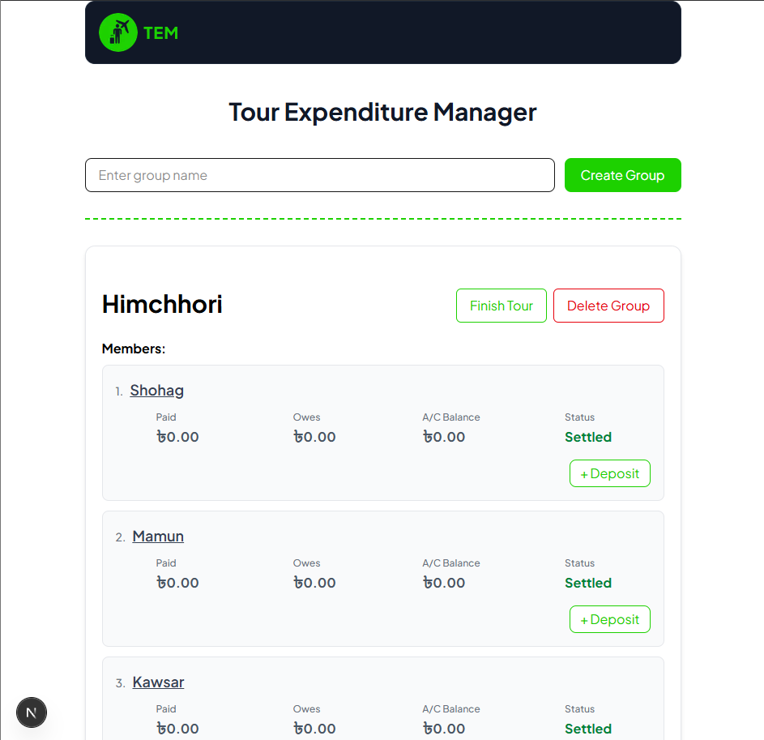
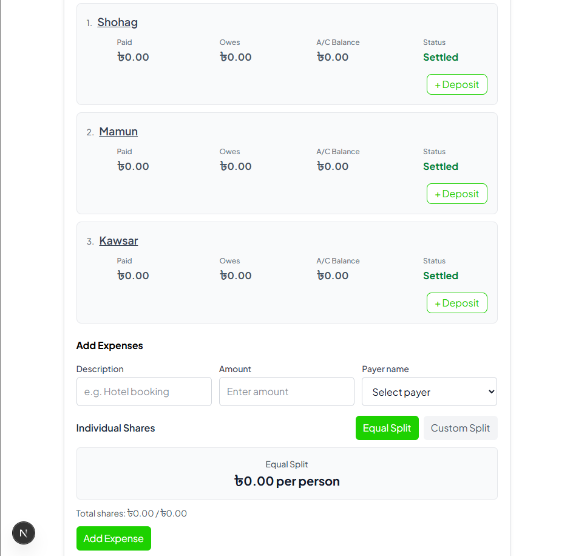
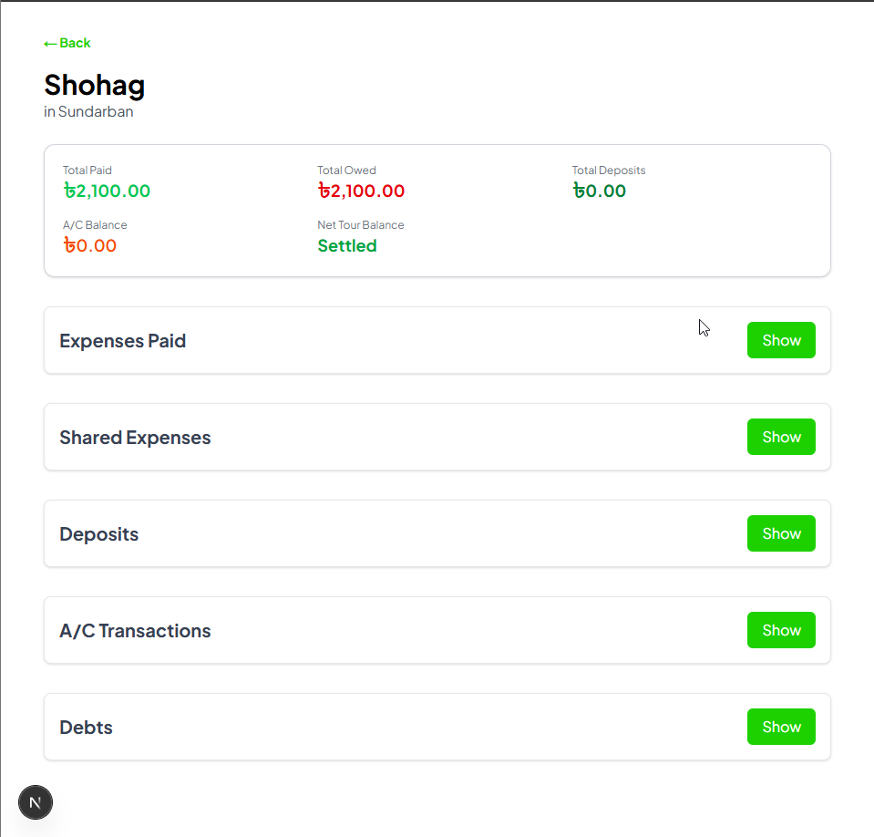
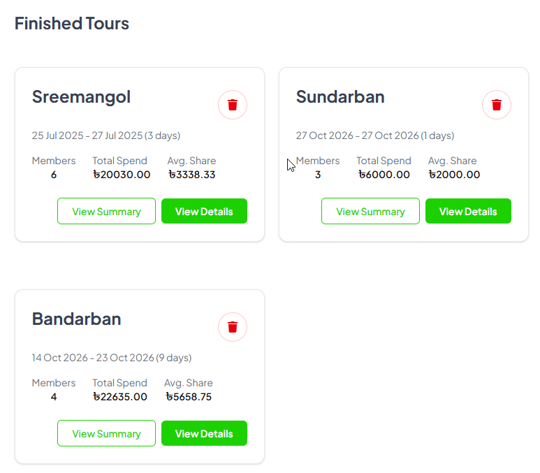
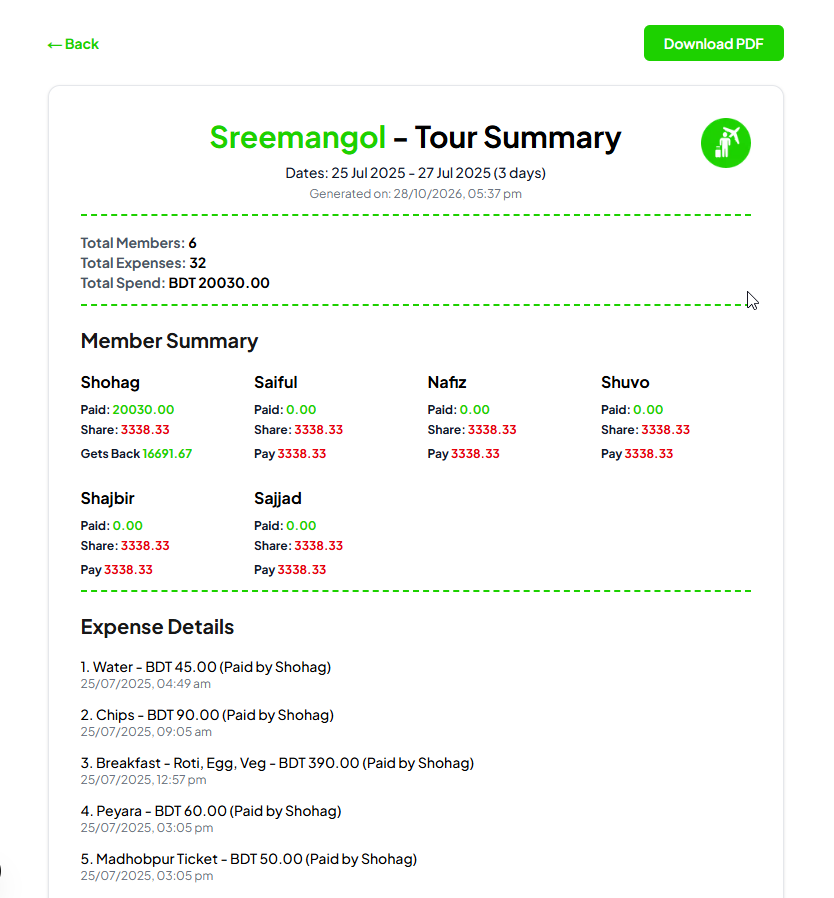

# Tour Expenditure Manager

A web-based application for managing group tour expenses, tracking individual contributions, and calculating how much each member owes. It helps friends and travel groups organize shared costs transparently, reduce manual calculations, and keep tour finances easy to manage.

## Overview

Tour Expenditure Manager simplifies group expense management by recording expenses, splitting shared costs, tracking individual payments, and calculating each member's financial responsibility. It supports equal splits, custom expense shares, individual items, a per-member A/C balance system, password-protected group locking, and PDF export of the final tour summary.

<div align="center">
  <table>
    <tr>
      <td align="center" width="50%">
        <br>
        <sub><b>Home Page</b></sub>
      </td>
      <td align="center" width="50%">
        <br>
        <sub><b>Members</b></sub>
      </td>
    </tr>
    <tr>
      <td align="center" width="50%">
        <br>
        <sub><b>Member Details</b></sub>
      </td>
      <td align="center" width="50%">
        <br>
        <sub><b>Finish Tour</b></sub>
      </td>
    </tr>
  </table>
  
  <br>
  <br>
  <sub><b>Summary Page & PDF Export</b></sub>
</div>

## Key Features

### Group & Expense Management
- **Group Management** — Create and manage tour groups and their members.
- **Expense Tracking** — Record expenses with descriptions, amounts, payer names, and timestamps.
- **Equal Expense Splitting** — Divide shared expenses equally among group members.
- **Custom Expense Splitting** — Assign specific amounts to members, with optional notes.
- **Individual Items** — Assign particular items to selected members while distributing the remaining bill as a shared expense.
- **Tour Completion** — Lock a completed tour to prevent further changes to its financial records.

### A/C Balance System (Virtual Wallet)
- **Per-Member A/C Wallet** — Each member can record deposits into their own A/C balance.
- **Virtual Money Note:** The A/C balance acts as *virtual money* to calculate debts. Real cash/online transfers must still happen outside the app to settle final differences.
- **Deposits** — Multiple deposits per member, each tracked as a separate transaction with delete functionality.
- **Settle Debts from A/C** — Members can use their virtual A/C balance to settle debts with one or more creditors.
- **Member Summary Page** — A per-member view with total paid, total owed, A/C balance, and net tour balance.
- **Lazy-Loaded Sections** — A/C transactions, shared expenses, expenses paid, and deposits load on demand.

### Group Locking (Security)
- **Password-Protected Lock** — Lock any group with a 6-digit PIN to prevent accidental edits.
- **Lock/Unlock Toggle** — Once a PIN is set, clicking "Lock" instantly locks the group. Clicking "Unlock" requires the PIN.
- **Delete Lock** — Permanently remove the PIN (requires the correct PIN).
- **Cascading Security** — Locking a group disables adding/editing expenses, members, and deposits. Deleting a locked group or finishing a tour requires the PIN.

### Reporting & Export
- **Web Summary Preview** — A clean summary page for every finished tour.
- **PDF Export** — Download a PDF summary with logo, watermark, dates, member breakdown, and full expense list.
- **Finished Tour Cards** — Compact summary cards with dates, member count, total spend, average share per person, and a lock status indicator.

### UI & Experience
- **Modern Theme** — Brand-colored accent, Plus Jakarta Sans font, dark navbar, and consistent buttons.
- **Loading Skeletons** — Custom skeleton screens for all pages (Home, Details, Summary, Member) for instant perceived load times.
- **Smooth Animations** — Fade-in-up for cards and hover scaling for buttons.
- **Responsive Layout** — Works on mobile and desktop.
- **Timezone-Safe** — All dates render in Bangladesh Standard Time (Asia/Dhaka).
- **In-App Guide** — A dedicated `/guide` page explaining how to use the app.

## Tech Stack

- **Frontend:** Next.js 16 (App Router), React 19, TypeScript
- **Styling:** Tailwind CSS v4
- **Backend:** Next.js API Routes
- **Database:** MongoDB (Atlas)
- **Authentication:** bcrypt (for 6-digit group lock PINs)
- **PDF Generation:** pdf-lib
- **Icons:** react-icons
- **Deployment:** Vercel

## Purpose

The goal of this project is to make group travel budgeting simpler, more transparent, and more convenient. Instead of calculating expenses manually, group members can use one application to organize costs, understand their financial responsibilities, and export a clean summary at the end of the tour.

## Getting Started

Clone the repository, install the dependencies, configure your MongoDB connection in the environment variables, and run the development server.

```bash
git clone https://github.com/MHShohag911/tour-expenditure-manager.git
cd tour-expenditure-manager
npm install
npm run dev
```

Create a `.env.local` file and add the MongoDB connection string required by the project.

Open [http://localhost:3000](http://localhost:3000) in your browser to access the application.

## Roadmap / Future Improvements

- Mobile-first PDF layout for printing
- Per-expense receipt image attachments
- Better offline support (PWA)
- Multi-currency support
- User accounts with authentication (currently no login — anyone with the URL can access any group)

## License

Copyright (c) 2026 M H Shohag. All Rights Reserved.

This project is a personal tool. No part of this codebase may be copied, modified, or distributed without explicit permission.

